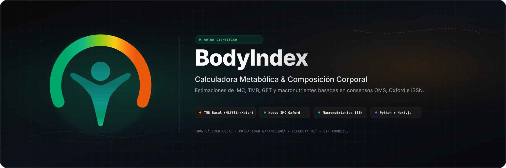

<p align="center">
  
</p>

<p align="center">
  Plataforma web moderna y suite en Python para el cálculo, análisis y estimación de <strong>IMC, Tasa Metabólica Basal (TMB), Gasto Energético Total (GET / TDEE) y Macronutrientes</strong> respaldados por la evidencia científica más reciente.
</p>

<p align="center">
  
  
  
  
  
  
</p>

---

## Sobre BodyIndex v2

**BodyIndex** ha evolucionado de un script de consola a una **plataforma científica completa y modular**. Integra un motor matemático riguroso en Python, una API REST con FastAPI, una aplicación web interactiva en Next.js con diseño responsivo a 60 fps y una interfaz de consola enriquecida.

### Consensos y Ecuaciones Científicas Integradas

* **Índice de Masa Corporal (IMC):**
  * **IMC Clásico (Quetelet - OMS):** Clasificación jerárquica oficial en 6 estratos de la OMS.
  * **Nuevo IMC (Oxford 2013 - Nick Trefethen):** Corrección con exponente $2.5$ para personas altas y bajas.
  * **Masa Grasa Relativa (RFM - Cedars-Sinai 2018):** Estimación de porcentaje de grasa basada en la relación estatura/cintura validada con absorciometría DEXA.
  * **Índice Cintura-Estatura (WHtR):** Indicador universal de riesgo cardiometabólico y adiposidad visceral ($< 0.50$).
* **Tasa Metabólica Basal (TMB / BMR):**
  * **Mifflin-St Jeor (1990):** Ecuación de referencia para población general avalada por la *Academy of Nutrition and Dietetics*.
  * **Katch-McArdle (1996):** Ecuación basada exclusivamente en masa libre de grasa (FFM / Tejido metabólicamente activo).
  * **Oxford / Henry (FAO/OMS/UNU 2005):** Ecuaciones modernas por rangos de edad.
* **Gasto Energético Total (GET / TDEE) y Nutrición:**
  * Factores de actividad física **PAL (Physical Activity Level)** oficiales.
  * Desglose fisiológico: TMB + Termogénesis de los Alimentos (**TEF**, ~10%) + Gasto de Actividad (**EAT + NEAT**).
  * Ajuste de objetivos: Déficit moderado ($-15\%$), Déficit rápido ($-25\%$), Mantenimiento ($0\%$), Superávit limpio ($+10\%$) y Volumen ($+15\%$).
  * Distribución de macronutrientes según guías de la **ISSN (International Society of Sports Nutrition)**.

> [!IMPORTANT]
> BodyIndex es un proyecto con fines educativos y cuantitativos. Sus estimaciones no sustituyen el diagnóstico, prescripción ni valoración personalizada de un profesional de la salud o la nutrición.

---

## Estructura del Proyecto

```text
body-index/
├── api/                      # Endpoints Serverless para Vercel
│   └── index.py              # Aplicación FastAPI con OpenAPI/Swagger
│
├── app/                      # Frontend Web Next.js 15 (App Router)
│   ├── globals.css           # Estilos Tailwind y gradientes de marca
│   ├── layout.tsx            # Metadata y estructura base
│   └── page.tsx              # Dashboard interactivo en tiempo real
│
├── assets/
│   ├── logo-bodyindex-vector.svg # Isotipo oficial vectorial
│   └── portada-body-index.svg    # Banner vectorial optimizado
│
├── components/               # Componentes UI en React / Tailwind
│   ├── Header.tsx            # Barra de navegación superior
│   ├── CalculatorForm.tsx    # Formulario interactivo con sliders y steppers
│   ├── MetricsDisplay.tsx    # Tarjetas de resultados, gráficos y macros
│   ├── MetricsExplainer.tsx  # Acordeón explicativo de fundamentos fisiológicos
│   └── ResultsReaderModal.tsx # Modal interpretativo con síntesis de voz
│
├── lib/                      # Lógica compartida y utilidades
│   ├── calculator.ts         # Motor de cálculo client-side reactivo
│   ├── exportReport.ts       # Exportación en alta resolución (A4 PDF y PNG)
│   ├── supabase.ts           # Capa de persistencia preparada para Supabase
│   └── types.ts              # Tipos estrictos TypeScript
│
├── src/                      # Núcleo científico en Python
│   ├── core/
│   │   ├── __init__.py
│   │   ├── models.py         # Modelos de datos y esquemas Pydantic v2
│   │   ├── imc.py            # IMC, Trefethen, RFM y WHtR
│   │   ├── tmb.py            # Mifflin-St Jeor, Katch-McArdle, Oxford
│   │   ├── get.py            # TDEE, TEF y macronutrientes
│   │   └── calculadora.py    # Fachada consolidada de cálculo
│   └── analizador.py         # CLI interactiva de consola
│
├── tests/                    # Suite de pruebas unitarias (Pytest)
│   ├── test_api.py           # Pruebas de endpoints FastAPI
│   ├── test_calculadora.py   # Pruebas de integración del motor
│   ├── test_get.py           # Pruebas de gasto energético y macros
│   ├── test_imc.py           # Pruebas de IMC, RFM y WHtR
│   └── test_tmb.py           # Pruebas de TMB y métodos
│
├── vercel.json               # Configuración de despliegue en Vercel
├── requirements.txt          # Dependencias Python
├── package.json              # Dependencias Node.js / Next.js
└── README.md
```

---

## Inicio Rápido

### Requisitos

* **Python 3.10 o superior**
* **Node.js 18 o superior** (para la interfaz web)

---

### 1. Interfaz Web (Next.js)

```bash
# Instalar dependencias
npm install

# Iniciar entorno de desarrollo híbrido (Next.js + Python FastAPI)
npm run dev
```

Abre en tu navegador [http://localhost:3000](http://localhost:3000) para acceder a la plataforma interactiva.

---

### 2. API REST (FastAPI)

```bash
# Instalar dependencias de Python
pip install -r requirements.txt

# Iniciar servidor API
uvicorn api.index:app --reload --port 8000
```

Documentación interactiva disponible en:
* **Swagger UI:** [http://localhost:8000/api/docs](http://localhost:8000/api/docs)
* **ReDoc:** [http://localhost:8000/api/redoc](http://localhost:8000/api/redoc)

---

### 3. Aplicación de Consola (CLI)

```bash
python src/analizador.py
```

---

### 4. Pruebas Unitarias

```bash
pytest tests/ -v
```

---

## Despliegue en Vercel & Supabase

### Vercel (Recomendado)
El proyecto cuenta con configuración unificada mediante `vercel.json` que compila el frontend Next.js y expone automáticamente los endpoints de Python en `/api` como funciones Serverless.

```bash
vercel
```

### Supabase (Opcional para persistencia)
Para habilitar guardado de historial o perfiles de usuario, define las siguientes variables en `.env.local`:

```env
NEXT_PUBLIC_SUPABASE_URL="https://tu-proyecto.supabase.co"
NEXT_PUBLIC_SUPABASE_ANON_KEY="tu-anon-key"
```

---

## Autor

Desarrollado por **Josué Chacae**.

<p>
  <a href="https://github.com/chacaejosue">
    
  </a>
</p>

---

## Licencia

Este proyecto se distribuye bajo la [Licencia MIT](./LICENSE). Puedes utilizarlo, modificarlo y distribuirlo libremente respetando los términos establecidos en la misma.
